# El destino de los aventureros: El juicio de los Celestiales (versión Twitch)

> 🌐 [English](README.md) · **Español**

▶ **Versión en línea:** https://fate-of-the-adventurers-twitch-production.up.railway.app/ (alojada en Railway; inicia sesión con Twitch. El acceso se limita a las cuentas que permita el mantenedor)

Sorteo **configurable** (de 1 a 50 premios) con **confirmación automática de presencia por el chat de Twitch**
(API oficial: OAuth + EventSub por WebSocket). Los cuatro Celestiales de Pandaria se turnan en rondas y Xuen recupera los premios que queden sin dueño.
Puedes usar la versión en línea de arriba o ejecutar todo en tu PC: un servidor Node.js y una página web. Sin dependencias npm ni servicios de terceros (solo Twitch; Railway solo si lo alojas allí).

## Requisitos
- **Node.js 22 o superior** (usa `fetch` y `WebSocket` nativos). Comprueba con `node --version`.
- Una cuenta de Twitch con acceso a https://dev.twitch.tv/console (Twitch puede pedir activar la verificación en dos pasos para registrar apps).

> 📷 **Sobre los pantallazos.** Los de las secciones 3–5 son de la interfaz real conectada a un **Twitch simulado** (cuenta ficticia `streamer_demo` y chat ficticio), con tiempos cortos para que un evento completo quepa en pocos minutos. Los pasos 1 y 2 no llevan pantallazos a propósito: la consola de Twitch y tu `.env` muestran tu cuenta y tus secretos.

## 1. Registrar la aplicación en Twitch (paso manual, una sola vez)
1. Entra en https://dev.twitch.tv/console/apps → **Register Your Application**.
2. **Name**: el que quieras (único en Twitch).
3. **OAuth Redirect URLs**: `http://localhost:3000/auth/callback` (debe coincidir **exactamente** con `TWITCH_REDIRECT_URI`; si cambias de puerto, cámbialo en ambos sitios).
4. **Category**: *Application Integration* (o la que prefieras). **Client Type**: **Confidential** (el secreto se queda en el servidor).
5. Crea la app, ábrela con **Manage**, copia el **Client ID** y pulsa **New Secret** para generar el **Client Secret** (solo se muestra una vez).

## 2. Configurar
```bash
copy .env.example .env      # en Linux/macOS: cp .env.example .env
```
Edita `.env`:
```
TWITCH_CLIENT_ID=...
TWITCH_CLIENT_SECRET=...
TWITCH_CHANNEL=tu_canal      # login en minúsculas; si lo omites, el canal de la cuenta que autorice
PORT=3000
```
`.env` y `data/` están en `.gitignore`. Ningún secreto llega al navegador.

## 3. Ejecutar
En Windows: doble clic en **`iniciar.bat`** (la primera vez crea `.env` y lo abre para que lo rellenes). O a mano:
```bash
node server.js
```
**No abras `public/index.html` con doble clic**: la página solo funciona servida por el servidor en `http://localhost:3000`.
Abre **http://localhost:3000** (usa `localhost`, no la IP) y pulsa **Conectar con Twitch**. Autoriza con la
cuenta que leerá el chat (normalmente la tuya, la del canal). El único permiso solicitado es
**`user:read:chat`**. La app muestra el estado: *conectado / reconectando / desconectado*.
Los tokens de cada cuenta se guardan en `data/streamers/<id-de-twitch>/tokens.json` (texto plano, solo en tu PC; las versiones anteriores usaban `data/tokens.json`, que ya no se lee: conéctate una vez más); no tendrás que volver a autorizar en
cada arranque. «Cerrar sesión de Twitch» los borra.

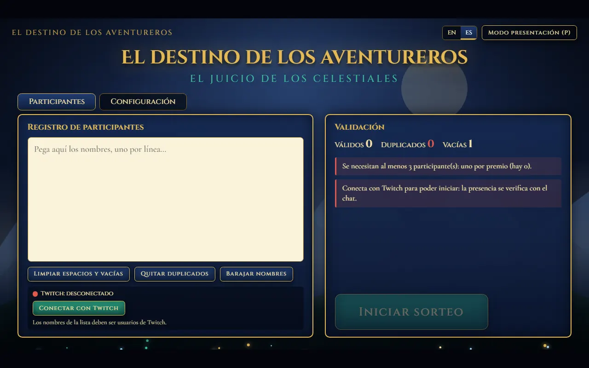

Tras autorizar, el panel muestra el estado de la conexión y el canal que se lee:

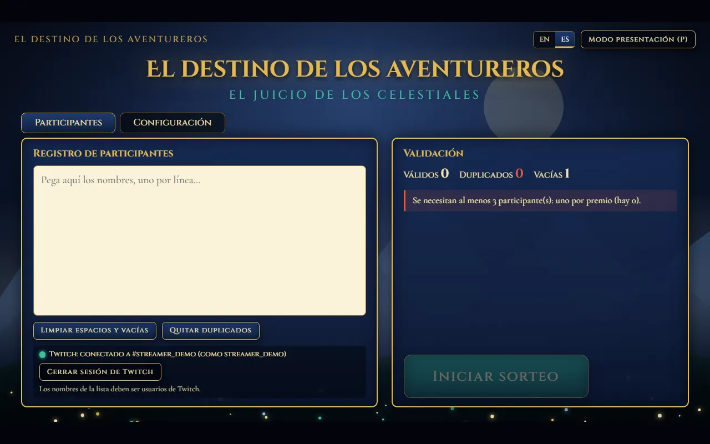


## 4. Configurar un sorteo (cantidad de premios y tiempos)

Pega los participantes (sus **logins de Twitch**, uno por línea). El panel cuenta las líneas válidas, duplicadas y vacías, comprueba que alcancen para los premios y avisa cuando todo está listo; al iniciar, el servidor verifica que cada login exista en Twitch. El botón **Barajar nombres** reordena la lista al azar (al iniciar, el sorteo la vuelve a barajar).

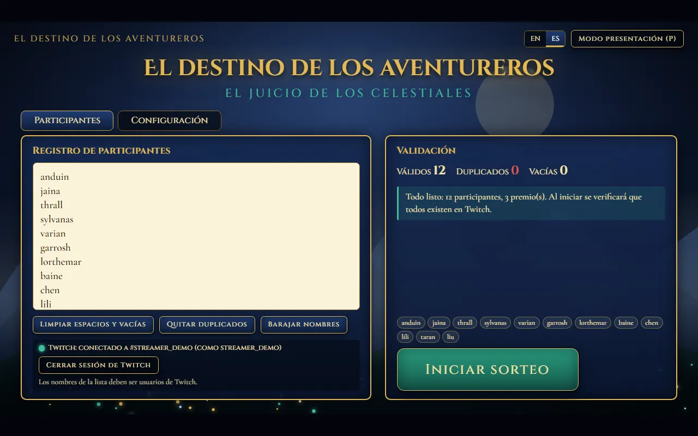

Después, en la pestaña **Configuración**:

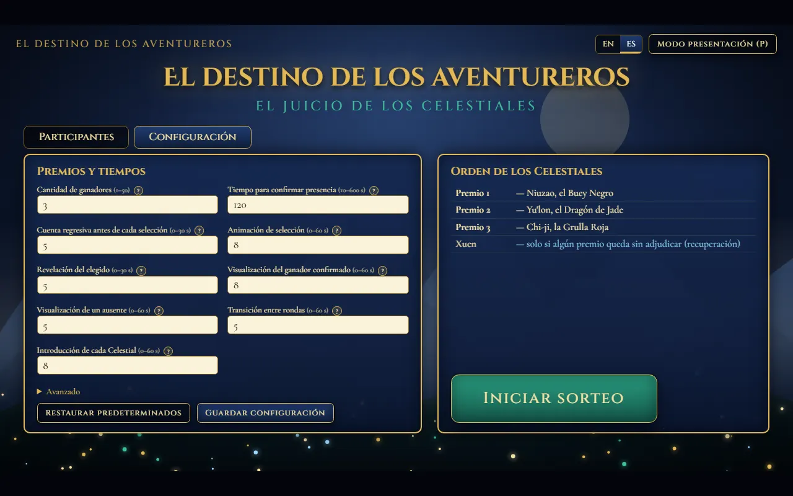

La sección **Avanzado** contiene el margen de entrega y el tiempo extra tras una caída de conexión:

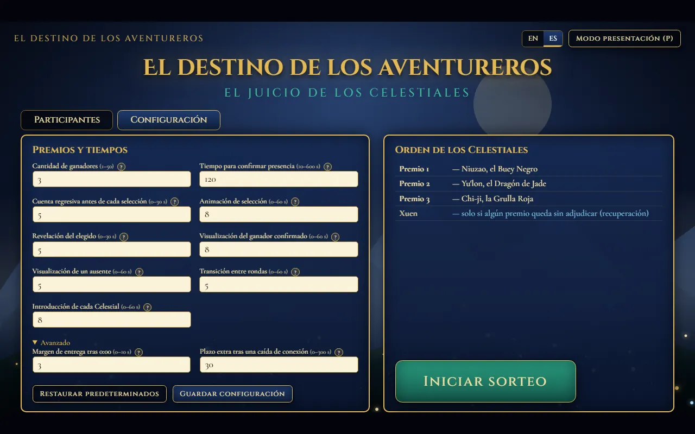

1. **Cantidad de ganadores**: de 1 a 50 (por defecto 3). No puede superar el número de participantes válidos; cada premio es para una persona distinta.
2. **Tiempos** (todos en segundos, enteros; se validan al escribir y otra vez en el servidor):

| Parámetro | Predeterminado | Rango |
|---|---|---|
| Tiempo para confirmar presencia en Twitch | 120 | 10–600 |
| Cuenta regresiva antes de cada selección | 5 | 0–30 |
| Animación de selección | 8 | 0–60 |
| Revelación del elegido | 5 | 0–30 |
| Visualización del ganador confirmado | 8 | 0–60 |
| Visualización de un participante ausente | 5 | 0–60 |
| Transición entre rondas (y aviso de «ronda desierta») | 5 | 0–60 |
| Introducción de cada Celestial | 8 | 0–60 |
| *Avanzado:* margen de entrega tras 0:00 (0 = estricto) | 3 | 0–10 |
| *Avanzado:* plazo extra tras una caída de conexión | 30 | 0–300 |

3. La **vista previa** muestra el orden de los Celestiales para esa cantidad de premios (con 8: Niuzao, Yu'lon, Chi-ji, Niuzao, Yu'lon, Chi-ji, Niuzao, Yu'lon).
4. **Restaurar predeterminados** (sin guardar aún), **Guardar configuración** y **Iniciar sorteo**. Iniciar usa y guarda lo que ves en el panel.

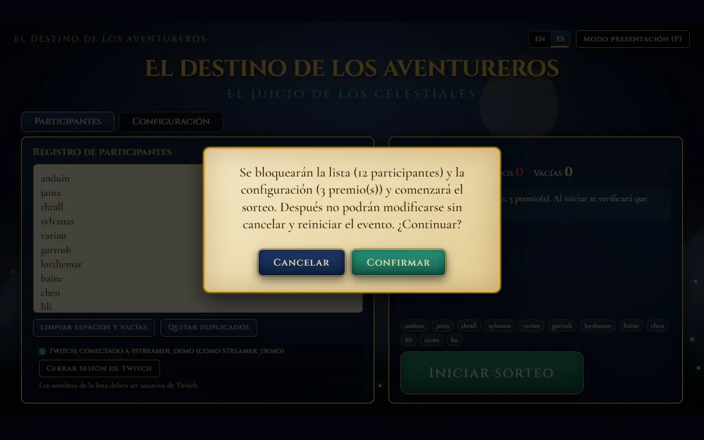

**Ejemplo: sorteo de 8 premios con 60 s de confirmación** → pega al menos 8 nombres en *Participantes*, en *Configuración* pon `8` en «Cantidad de ganadores» y `60` en «Tiempo para confirmar presencia», comprueba la vista previa, pulsa **Iniciar sorteo** y confirma.

La configuración se guarda **en el servidor** (`data/streamers/<id-de-twitch>/config.json`, sin credenciales) y persiste entre sesiones. **Cada cuenta de Twitch tiene su propia carpeta** (identificada por su ID numérico, que no cambia): la configuración y el historial nunca se comparten ni se pisan entre streamers, e iniciar sesión con otra cuenta carga la configuración de esa cuenta. Cada cuenta con sesión iniciada maneja su propio evento de forma independiente. **Queda bloqueada al iniciar el evento**: el servidor rechaza cualquier cambio hasta que termine o se cancele/reinicie con confirmación. Los valores por defecto y los límites viven en un solo sitio: `core.js → DEFAULT_CONFIG / LIMITS`.

## 5. Cómo transcurre el evento (flujo automático)
Tras **Iniciar sorteo** todo avanza solo, con tus duraciones:

```
Introducción del Celestial → cuenta atrás → selección → revelación → espera de confirmación (hasta N s)
   → ganador visible | ausente visible → (otro candidato: cuenta atrás) … → transición → siguiente ronda
```
- **El plazo de confirmación empieza cuando termina la revelación**: el nombre ya es visible y se está escuchando el chat desde que empezó la revelación (un mensaje en ese momento ya confirma), pero **ninguna animación previa descuenta tiempo**. El plazo lo lleva el **servidor**; la página solo lo dibuja.
- **Cualquier mensaje del elegido en el chat** confirma su presencia (sin comando).
- **Barajado:** al iniciar el sorteo, la lista de participantes se baraja en un orden aleatorio seguro (Fisher–Yates con `crypto.getRandomValues`), así que el orden en que se escribieron los nombres no influye; queda anotado en el historial.
- **Último candidato:** siempre que quede **una sola** persona elegible para un sorteo (porque los demás no respondieron o ya ganaron, Xuen incluido), ya no hay nada que sortear: se salta la cuenta atrás y el roll y esa persona se revela de inmediato como candidata (aun así debe confirmar su presencia a tiempo).
- **Controles del presentador:** *Confirmar presencia* (respaldo manual), *Pausar* (congela la fase en curso, también el plazo de confirmación; se muestra «EVENTO EN PAUSA»), *Saltar espera* (introducción, ganador, ausente, transición), *Descalificar del sorteo*, *Cancelar sorteo*, *Reiniciar sorteo*.

### Paso a paso durante un evento

**Presentación del Celestial, cuenta atrás, selección y revelación.** Cada ronda presenta a su Celestial, cuenta hacia atrás, ejecuta la animación de selección y revela a la persona elegida.

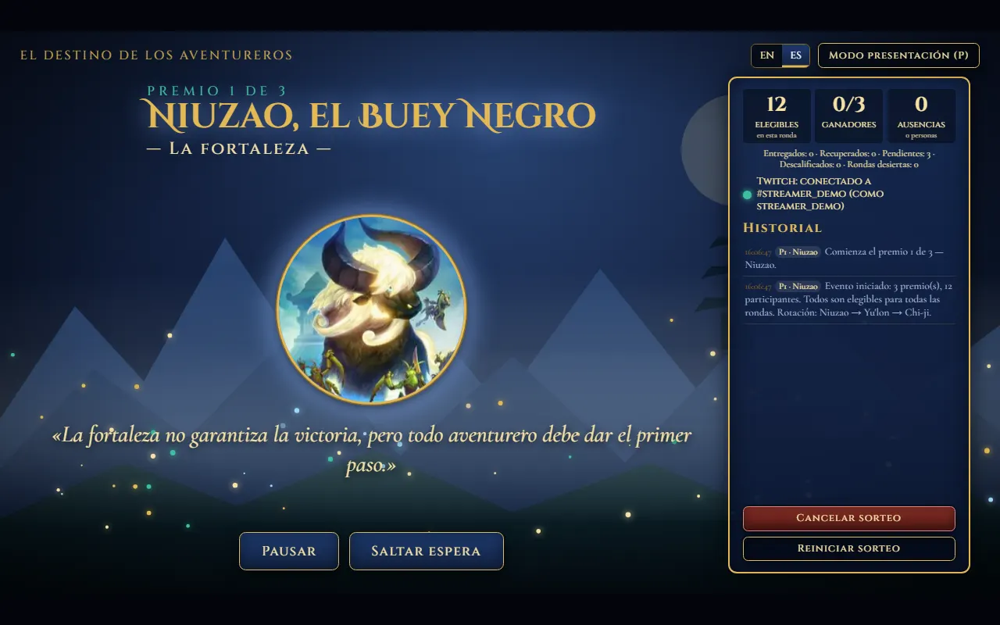

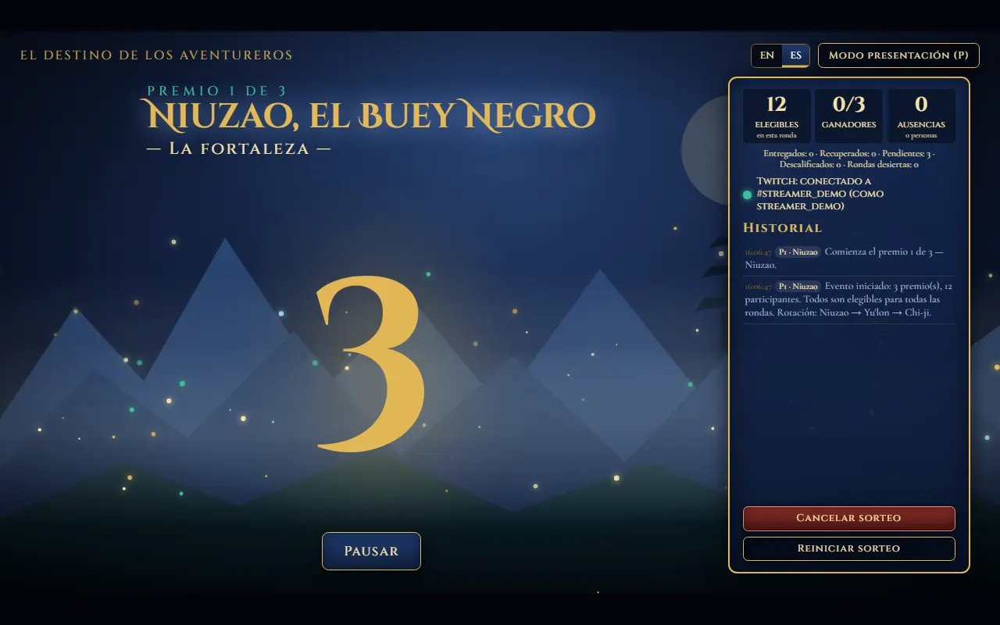

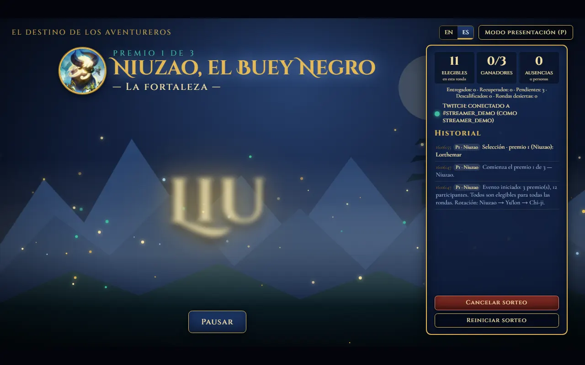

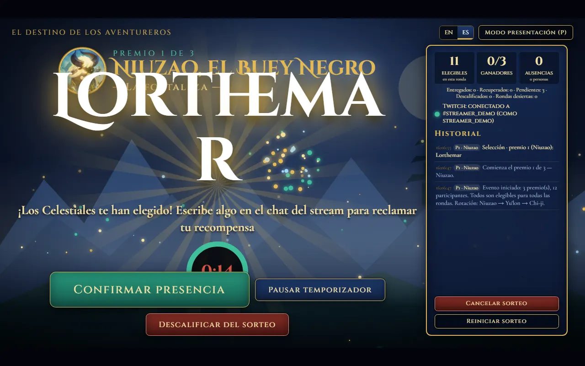

**Esperando al chat.** Desde la revelación el servidor escucha el chat: el primer mensaje de la persona elegida (identificada por su ID de Twitch) la confirma. También puedes **pausar**, **descalificar** (con confirmación y motivo escrito) o **confirmar manualmente**.

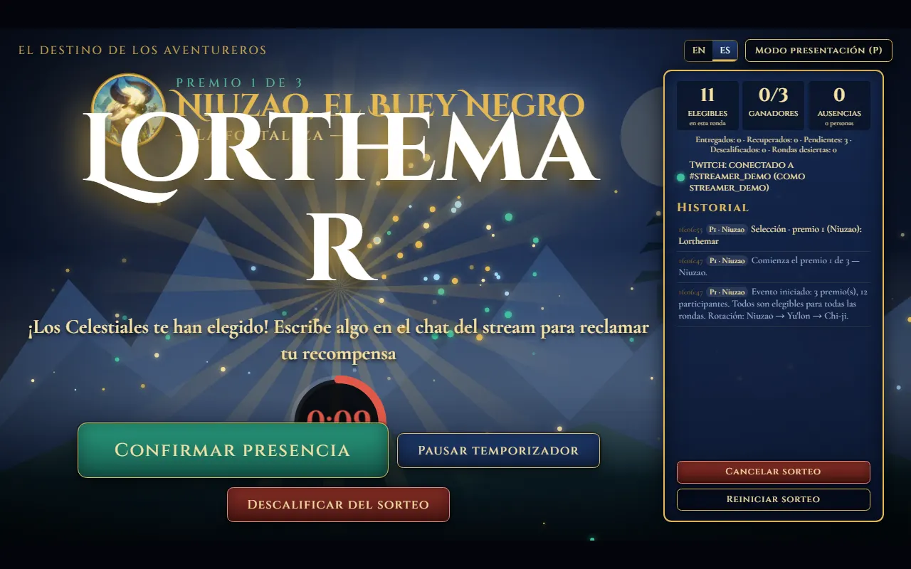

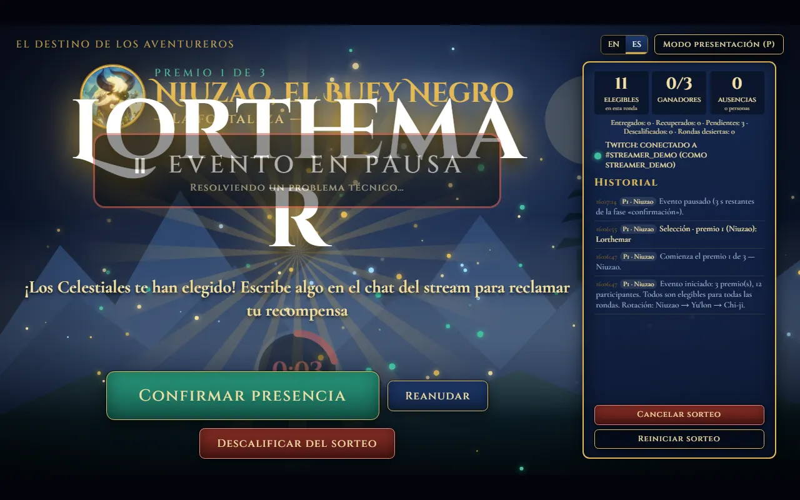

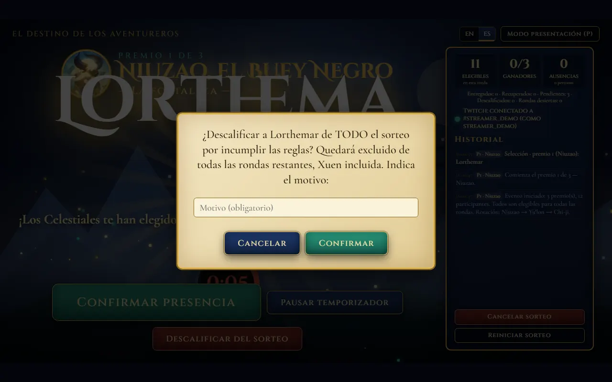

**Ganador y transición.** Se muestra al ganador confirmado y empieza la siguiente ronda con el siguiente Celestial.

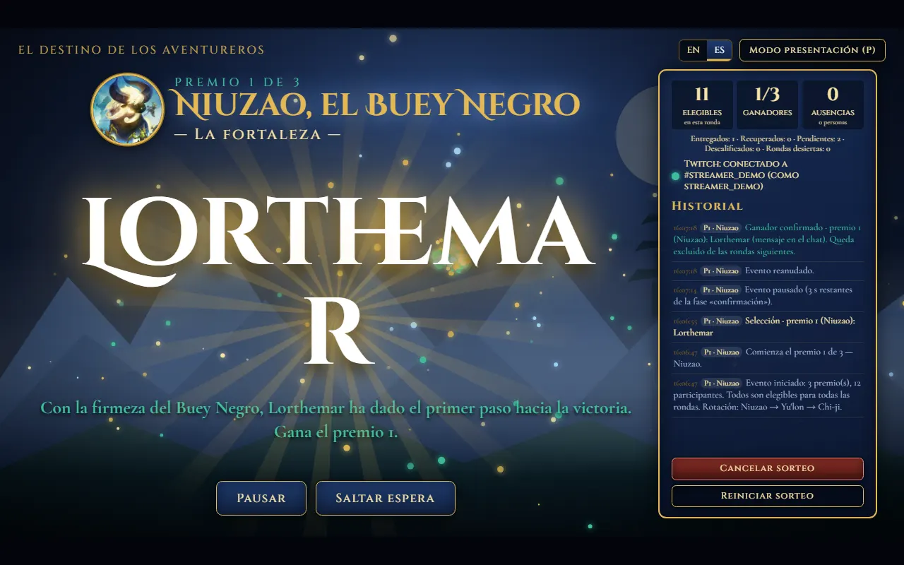

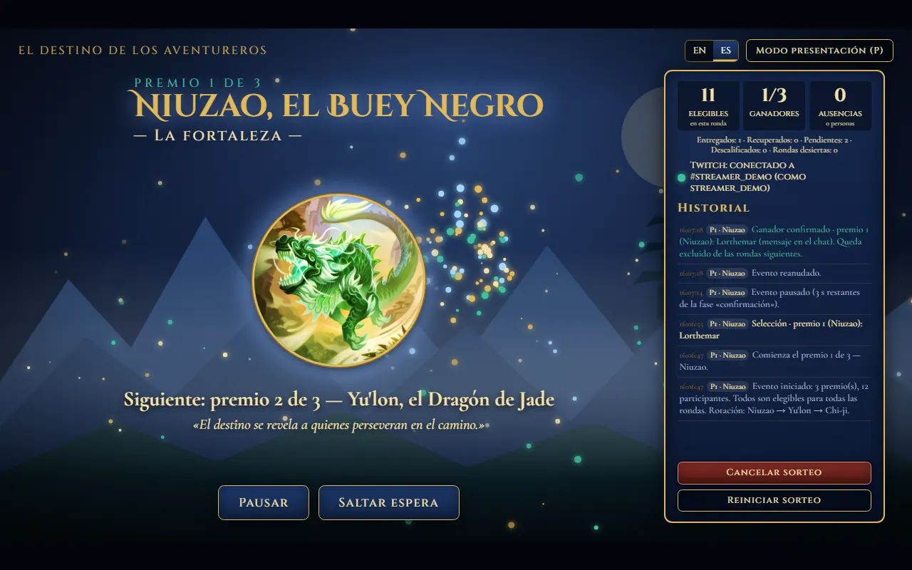

**Caída de conexión.** Si la conexión con Twitch no es fiable al agotarse el tiempo, **nadie se declara ausente**: el estado pasa a *Verificando* y, al volver la conexión, la persona elegida recibe tiempo extra.

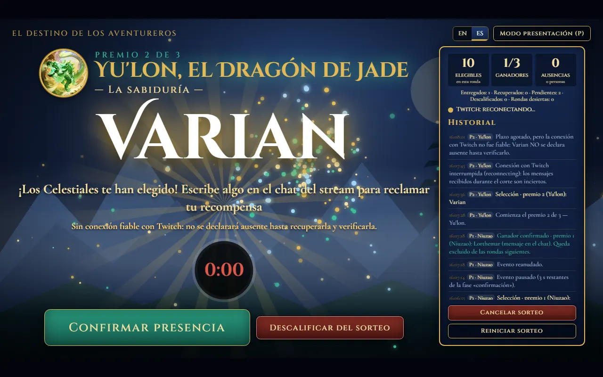

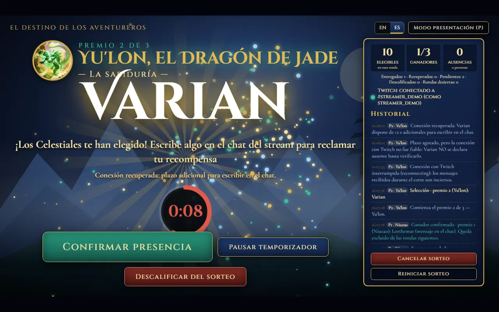

**Ausencia.** Si el tiempo se agota con conexión fiable, la persona se muestra como ausente (excluida solo de esa ronda) y se sortea otro candidato.

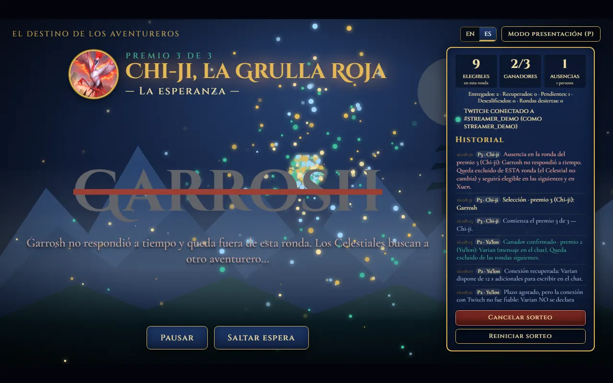

**Pantalla final e historial.** Cuando todos los premios están asignados (o recuperados por Xuen), se muestran los ganadores con su Celestial; el presentador entrega los códigos en persona.


### Rotación de Celestiales
Las rondas principales rotan **circularmente** entre Niuzao, Yu'lon y Chi-ji hasta completar los premios. El Celestial depende del **índice de la ronda**, no de los ganadores. Una **ausencia no cambia el Celestial**: se elige a otro participante bajo el mismo. La rotación solo avanza cuando se confirma un ganador o la ronda queda desierta.

### Elegibilidad
Todos empiezan elegibles para todas las rondas. Cada extracción se hace entre los elegibles *de la ronda en curso*:

| Situación | Efecto |
|---|---|
| **Ausencia** (no escribe a tiempo) | Excluido **solo de esa ronda** (no de ese Celestial: ausente en el premio 1 de Niuzao, puede salir en el premio 4 aunque sea otra vez Niuzao). Puede participar en las siguientes y en Xuen. |
| **Ganador confirmado** | Excluido de todo lo posterior. Cada persona gana como máximo un premio. |
| **Descalificación global** (explícita del presentador) | Pide confirmación y **motivo obligatorio**. Excluido de todas las rondas restantes, Xuen incluida. |
| **Ronda sin elegibles** | Declarada **desierta**: su premio pasa a recuperación y el evento continúa con la siguiente. |

La elegibilidad se calcula siempre desde los registros (`core.js → eligible()`), no desde un conjunto que se vaya vaciando.

### Xuen — La fuerza (recuperación)
Es el Celestial **exclusivo** de las rondas de recuperación; no es una prueba obligatoria. Al terminar las rondas principales:
- **Todos los premios tienen ganador** → el evento termina; Xuen no aparece.
- **Quedan premios pendientes** → Xuen se activa solo e intenta adjudicar cada uno (todos bajo Xuen, sin alternar con los otros). Los ganadores de Xuen reciben los premios pendientes **en orden** (el de menor número primero).
- Ganadores y descalificados no participan; los **ausentes de las rondas principales sí**. Un **ausente en Xuen** queda excluido de **toda** la recuperación.
- Si se agotan los candidatos, los premios restantes quedan **definitivamente sin adjudicar** y el evento termina como incompleto.

### Estados e historial
Cada premio tiene estado: *pendiente*, *en curso*, *adjudicado*, *en recuperación* (ronda desierta), *recuperado por Xuen* o *sin adjudicar*. La pantalla muestra premios entregados / recuperados / pendientes, y distingue **eventos de ausencia** de **personas únicas ausentes**. El historial (en pantalla y en `data/streamers/<id-de-twitch>/historial.jsonl`) lleva premio, Celestial y si fue ronda principal o recuperación.

**OBS:** añade una *Fuente de navegador* con `http://localhost:3000/?view=presentation` (sin controles; los botones solo aparecen al pasar el ratón por la parte inferior). También puedes usar la tecla `P` en el panel normal.

## Despliegue en Railway (opcional, modo remoto)

Por defecto el servidor es solo local (`127.0.0.1`, sin inicio de sesión en el panel). Para ejecutarlo en un servidor público como [Railway](https://railway.com) hace falta un proceso Node de larga duración, así que no sirven los alojamientos estáticos (GitHub Pages) ni las plataformas sin servidor (Vercel).

1. **Servicio**: crea un servicio de Railway desde este repositorio. `railway.json` define el comando de arranque y la comprobación `/healthz`; la plataforma aporta `PORT`.
2. **Volumen**: añade un volumen y móntalo (p. ej. en `/data`); define `DATA_DIR=/data` para que tokens, configuración e historial sobrevivan a los redespliegues.
3. **Variables** (Railway → Variables, nunca en el repositorio): `TWITCH_CLIENT_ID`, `TWITCH_CLIENT_SECRET`, `TWITCH_CHANNEL`, `DATA_DIR` y
   - `PUBLIC_URL`: el origen público con HTTPS, p. ej. `https://tu-app.up.railway.app` (sin ruta). Al definirla se activa el **modo remoto**.
   - `ALLOWED_LOGINS`: logins de Twitch que pueden iniciar sesión, separados por comas, o `*` para admitir **cualquier** cuenta de Twitch (por defecto `TWITCH_CHANNEL`).
   - `MAX_STREAMERS` (opcional, 20 por defecto): cuántos streamers pueden estar conectados a la vez; cada uno mantiene su propia conexión con Twitch.
4. **Consola de Twitch**: añade `PUBLIC_URL/auth/callback` a las OAuth Redirect URLs de la aplicación (debe coincidir con `TWITCH_REDIRECT_URI`, que por defecto vale eso).
5. Abre `PUBLIC_URL` e inicia sesión con Twitch.

**Varios streamers a la vez:** cada streamer que inicia sesión tiene su propia conexión a Twitch, sus tokens, su motor de sorteo, su configuración y su historial; la cookie de sesión lleva su ID de Twitch, así que cada persona solo ve y maneja su propio evento. En modo remoto cada streamer lee **el chat de su propio canal** (`TWITCH_CHANNEL` se ignora). Un streamer que cierra sesión sin evento en marcha se libera de la memoria; con un evento en marcha se conserva hasta que termine.

En modo remoto: el panel, el flujo de estado y todas las órdenes exigen una sesión (cookie HttpOnly, Secure, SameSite=Lax, 12 h) que se obtiene iniciando sesión con una cuenta permitida; cualquier otra cuenta se rechaza antes de guardar nada. `Host` y `Origin` deben coincidir con `PUBLIC_URL`. El servidor no arranca sin un `PUBLIC_URL` con `https://` y una lista de cuentas permitidas. Las sesiones viven en memoria, así que tras un reinicio hay que volver a iniciar sesión (los tokens de Twitch persisten en el volumen). `/healthz` devuelve `ok` y ningún dato.

## Idiomas (i18n)
La interfaz está disponible en **inglés (por defecto)** y **español**, con el mismo criterio que DocFlow: el inglés es el idioma por defecto **independientemente del idioma del navegador**.
- **Selector EN | ES** en la esquina superior derecha. La elección se recuerda en el navegador (`localStorage`: `celestiales.locale`) y también se puede forzar con `?lang=es` (útil en la fuente de navegador de OBS: `http://localhost:3000/?view=presentation&lang=es`).
- El cambio es inmediato y lo traduce **todo**, incluido el historial ya generado: el motor guarda *claves y parámetros* y la página los traduce al idioma activo. `historial.jsonl` guarda además el texto en inglés.
- Las páginas de error del servidor (OAuth) usan el idioma elegido (cookie `celestiales_lang`). La consola del servidor está en inglés; con `LANG_UI=es` sale en español.
- Los nombres de los participantes y los motivos que escribas **nunca se traducen**.
- **Textos:** `locales/en.js` y `locales/es.js` (incluidos los textos narrativos de los Celestiales, `story.*`). **Añadir un idioma:** copia `locales/en.js` a `locales/xx.js`, tradúcelo, regístralo en `i18n.js` (`SUPPORTED` y los `require`/globales de arriba), en `server.js` (lista de archivos compartidos) y como `<script>` en `public/index.html`/`index.html`. Si falta una clave se usa la inglesa. Las pruebas comprueban que ambos catálogos tengan las mismas claves y parámetros y que toda clave usada exista.

## Cómo se garantiza la integridad
| Requisito | Implementación |
|---|---|
| Aleatoriedad y registro en el servidor | `core.js`: `crypto.getRandomValues` con rechazo (sin sesgo de módulo). El navegador solo envía órdenes; no recibe el nombre del candidato hasta la revelación. |
| Identidad | Se compara el `chatter_user_id` que entrega Twitch con el ID resuelto del candidato (no el texto del nombre). Los demás usuarios se ignoran. |
| Idempotencia | Se descartan `metadata.message_id` repetidos (capa EventSub) y `message_id` de chat repetidos (capa sorteo). |
| Un solo temporizador | Todas las fases (animaciones, esperas y plazo) pasan por un único programador que cancela la fase anterior; un callback de una fase ya sustituida se ignora. |
| Plazo vs. mensaje | Único punto de resolución (`settle`): el primer resultado válido gana. Un plazo vencido se procesa **una sola vez** y los mensajes posteriores no se aceptan. |
| Margen de entrega | Tras 0:00 hay `lateSec` (3 s por defecto) en los que un mensaje enviado justo antes aún puede llegar y confirmar; pasado ese margen, no se acepta. Con `0` el modo es estricto. |
| Caída de conexión | Si la conexión no es fiable durante la ventana, **no se declara ausente**: pasa a *Verificando*. Al recuperarla se concede un plazo extra (`graceSec`) y un mensaje del elegido lo confirma. |
| Reconexión | `session_reconnect` sin hueco; pérdida de keepalive → reintentos exponenciales; refresco automático de tokens; validación horaria. |
| Códigos de premio | No se muestran ni almacenan. |

## Limitaciones y cosas que requieren atención
- **Twitch no reenvía los mensajes perdidos** durante una caída del WebSocket ni ofrece API oficial del historial del chat. Tras un corte se concede el plazo extra; si el elegido ya había escrito durante el corte, usa **Confirmar presencia** si lo ves en el chat.
- **Duración total:** con los tiempos por defecto cada premio ronda 30–35 s de animaciones y esperas *más* el plazo de confirmación; un sorteo grande puede tardar bastante. Ajusta los tiempos o usa *Saltar espera*.
- **Pausa:** pausa la fase en curso (incluida la confirmación); durante el margen de entrega tras 0:00 no se puede pausar.
- Los nombres de la lista deben ser **logins** de Twitch (letras, números y `_`). Se verifican en Twitch al iniciar.
- Máximo 3 conexiones WebSocket por token de usuario: no abras dos instancias del servidor a la vez.
- Si lees el chat de **otro canal** (`TWITCH_CHANNEL`), la cuenta autorizada debe poder leer ese chat.
- Si **reinicias el servidor** a mitad de un sorteo, el estado **no se restaura** (el historial en disco sí queda; la configuración guardada también). Actualizar la página (F5) no afecta: el servidor es la fuente de verdad.
- El servidor solo escucha en `127.0.0.1` y rechaza peticiones con `Host`/`Origin` ajenos; no lo expongas a internet.
- **No verificado contra Twitch real** (no hay credenciales en este entorno): se comprobó la lógica, el protocolo según la documentación oficial y la interfaz completa con un Twitch simulado. Haz una **prueba real antes del directo** con una cuenta incluida en la lista.

## Pruebas
```bash
node --test
```
150 pruebas (~25 s): configuración (valores por defecto, validación de negativos/decimales/texto/rangos/premios > participantes), rotación (1, 3, 5, 8 y 10 premios), ausencias que no cambian el Celestial, elegibilidad por ronda, ganadores, descalificación global, rondas desiertas, Xuen (activación, varios premios, ausentes, agotamiento), temporizadores con **reloj simulado** (plazo configurable, comienza tras la revelación, expira una sola vez, margen de entrega, modo estricto, pausa, un solo temporizador activo, restauración), configuración bloqueada, reinicio sin exclusiones heredadas, caídas de conexión y protocolo OAuth/EventSub con WebSocket y `fetch` simulados. Pruebas de **i18n**: inglés por defecto, paridad de claves y parámetros EN/ES, cobertura de las claves usadas, plurales, respaldo al inglés y página del servidor por cookie. Pruebas de **contrato** congelan el estado que recibe la página, las entradas del historial y el estado guardado; pruebas del **servidor** cubren rutas, códigos de estado, sesiones y SSE; pruebas de **paridad** comprueban que los archivos compartidos (`core.js`, `i18n.js`, `locales/`, `css/app.css`, `ui/*.js`) y la página son idénticos en la versión manual (se omiten, de forma visible, si el repositorio manual no está clonado al lado; con `REQUIRE_SIBLING=1` su ausencia es un error, como en la integración continua).

## Estructura
```
Dominio (compartido con la versión manual, archivos idénticos)
core.js            el motor del evento: configuración, rotación, elegibilidad, máquina de estados, historial
i18n.js            internacionalización (idioma por defecto EN) · locales/en.js, locales/es.js: catálogos
css/app.css        los estilos de la página
ui/*.js            la lógica de la página (espejo del estado, panel de configuración, escenario, efectos), como scripts clásicos

Servidor de Twitch
server.js          punto de entrada: lee el entorno y arranca el servidor
server/            app (rutas, OAuth, SSE), configuración, sesiones, páginas y archivos estáticos
twitch.js          fachada de Twitch por streamer · twitch/auth.js (tokens, OAuth, Helix) · twitch/eventsub.js (WebSocket)
game.js            envoltorio del motor: lista verificada, identidades, configuración e historial persistidos
tenants.js         una conexión + un motor por streamer con sesión iniciada
store.js           datos por streamer: data/streamers/<id-de-twitch>/ (config + historial)
logging.js         texto seguro para la consola

Página (versión Twitch)
public/index.html  estructura de la página (idéntica a la manual)
public/adapter.js  el único archivo de la interfaz que cambia: habla con el servidor (HTTP + SSE)

Otros
tests/             pruebas automáticas · docs/ARCHITECTURE.md: cómo encajan las piezas · docs/REFACTORING.md: registro de cambios
data/              streamers/<id-de-twitch>/ con tokens.json, config.json e historial.jsonl (generados, fuera de control de versiones)
```
