# The Fate of the Adventurers: The Trial of the Celestials (v3 · Twitch)

> 🌐 **English** · [Español](README.es.md)

▶ **Live version:** https://fate-of-the-adventurers-twitch-production.up.railway.app/ (hosted on Railway; sign in with Twitch. Access is limited to the accounts the maintainer allows)

A **configurable** draw (1 to 50 prizes) with **automatic presence confirmation through Twitch chat**
(official API: OAuth + EventSub over WebSocket). The four Celestials of Pandaria take turns in rounds, and Xuen recovers any prize left without an owner.
You can use the hosted version above or run everything on your PC: a Node.js server and a web page. No npm dependencies and no third-party services (only Twitch; Railway only if you host it there).

## Requirements
- **Node.js 22 or later** (uses native `fetch` and `WebSocket`). Check with `node --version`.
- A Twitch account with access to https://dev.twitch.tv/console (Twitch may ask you to enable two-factor authentication to register apps).

> 📷 **About the screenshots.** Those in sections 3–5 are taken from the real interface connected to a **simulated Twitch** (fictional account `streamer_demo` and fictional chat), with short timings so a whole event fits in a few minutes. Steps 1 and 2 have no screenshots on purpose: the Twitch console and your `.env` show your account and secrets.

## 1. Register the application on Twitch (manual step, one time)
1. Go to https://dev.twitch.tv/console/apps → **Register Your Application**.
2. **Name**: anything you like (must be unique on Twitch).
3. **OAuth Redirect URLs**: `http://localhost:3000/auth/callback` (it must match **exactly** `TWITCH_REDIRECT_URI`; if you change the port, change it in both places).
4. **Category**: *Application Integration* (or whichever you prefer). **Client Type**: **Confidential** (the secret stays on the server).
5. Create the app, open it with **Manage**, copy the **Client ID** and press **New Secret** to generate the **Client Secret** (it is shown only once).

## 2. Configure
```bash
copy .env.example .env      # on Linux/macOS: cp .env.example .env
```
Edit `.env`:
```
TWITCH_CLIENT_ID=...
TWITCH_CLIENT_SECRET=...
TWITCH_CHANNEL=your_channel      # lowercase login; if omitted, the channel of the account that authorizes
PORT=3000
```
`.env` and `data/` are in `.gitignore`. No secret ever reaches the browser.

## 3. Run
On Windows: double-click **`iniciar.bat`** (the first time it creates `.env` and opens it for you to fill in). Or by hand:
```bash
node server.js
```
**Do not open `public/index.html` by double-clicking**: the page only works when served by the server at `http://localhost:3000`.
Open **http://localhost:3000** (use `localhost`, not the IP) and press **Connect with Twitch**. Authorize with the
account that will read the chat (normally yours, the channel owner's). The only permission requested is
**`user:read:chat`**. The app shows the status: *connected / reconnecting / disconnected*.
Each account's tokens are stored in `data/streamers/<twitch-id>/tokens.json` (plain text, only on your PC; older versions used `data/tokens.json`, which is no longer read: connect once again); you will not need to re-authorize on every start.
"Sign out of Twitch" deletes them.

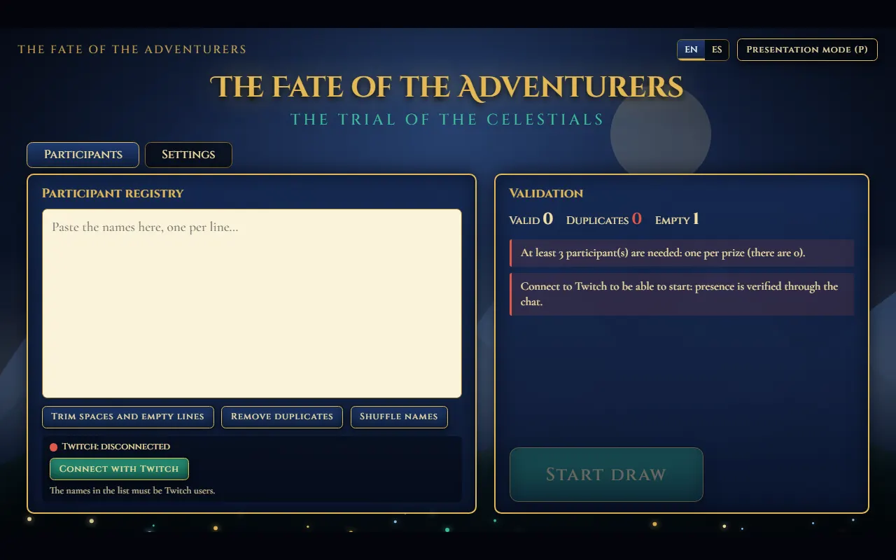

After authorizing, the panel shows the connection status and the channel being read:

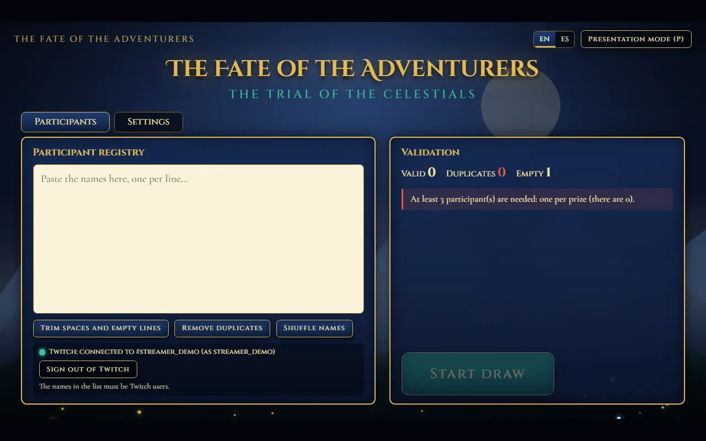


## 4. Set up a draw (number of prizes and timings)

Paste the participants (their **Twitch logins**, one per line). The panel counts valid, duplicate and empty lines, checks that there are enough for the prizes and tells you when everything is ready; at start, the server checks that every login exists on Twitch.

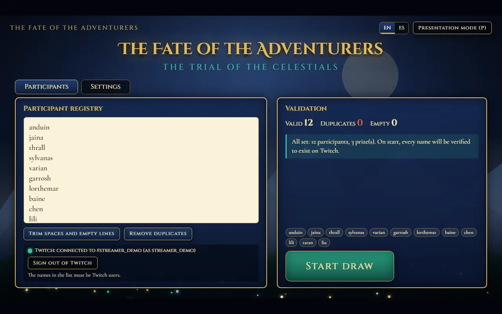

Then, in the **Settings** tab:

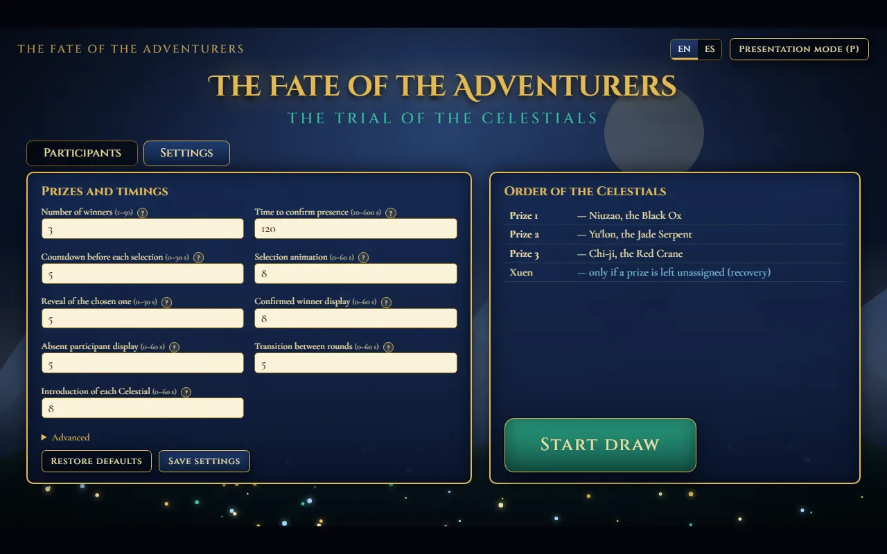

The **Advanced** section holds the delivery margin and the extra time after a connection drop:

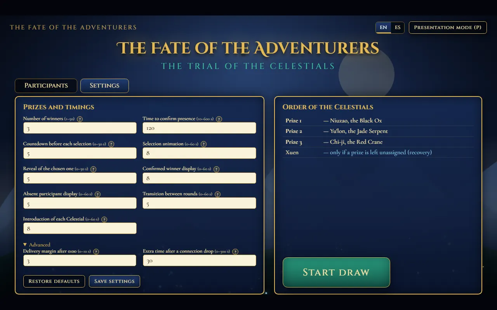

1. **Number of winners**: 1 to 50 (default 3). It cannot exceed the number of valid participants; each prize goes to a different person.
2. **Timings** (all in whole seconds; validated as you type and again on the server):

| Setting | Default | Range |
|---|---|---|
| Time to confirm presence on Twitch | 120 | 10–600 |
| Countdown before each selection | 5 | 0–30 |
| Selection animation | 8 | 0–60 |
| Reveal of the chosen one | 5 | 0–30 |
| Confirmed winner display | 8 | 0–60 |
| Absent participant display | 5 | 0–60 |
| Transition between rounds (and the "deserted round" notice) | 5 | 0–60 |
| Introduction of each Celestial | 8 | 0–60 |
| *Advanced:* delivery margin after 0:00 (0 = strict) | 3 | 0–10 |
| *Advanced:* extra time after a connection drop | 30 | 0–300 |

3. The **preview** shows the order of the Celestials for that number of prizes (with 8: Niuzao, Yu'lon, Chi-ji, Niuzao, Yu'lon, Chi-ji, Niuzao, Yu'lon).
4. **Restore defaults** (not saved yet), **Save settings** and **Start draw**. Starting uses and saves what you see in the panel.
5. Each option has a **"?" icon** with an explanation (hover it or focus it with the keyboard).

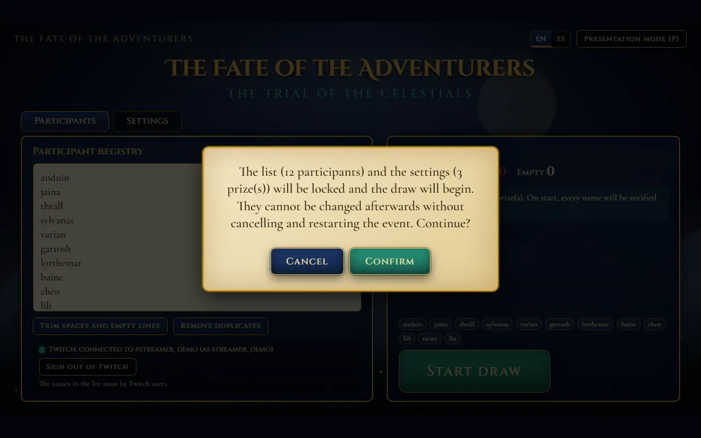

**Example: an 8-prize draw with 60 s to confirm** → paste at least 8 names in *Participants*, in *Settings* enter `8` for "Number of winners" and `60` for "Time to confirm presence", check the preview, press **Start draw** and confirm.

The settings are stored **on the server** (`data/streamers/<twitch-id>/config.json`, no credentials) and persist between sessions. **Each Twitch account has its own folder** (keyed by its numeric user ID, which never changes): settings and history are never shared or overwritten between streamers, and signing in with another account loads that account's own settings. Each signed-in account runs its own event independently. **They are locked once the event starts**: the server rejects any change until it ends or is cancelled/restarted with confirmation. Defaults and limits live in a single place: `core.js → DEFAULT_CONFIG / LIMITS`.

## 5. How the event runs (automatic flow)
After **Start draw** everything advances on its own, using your durations:

```
Celestial introduction → countdown → selection → reveal → wait for confirmation (up to N s)
   → winner shown | absent shown → (another candidate: countdown) … → transition → next round
```
- **The confirmation time starts when the reveal ends**: the name is already visible and the chat is already being listened to from the start of the reveal (a message at that moment already confirms), but **no earlier animation uses up any time**. The **server** keeps the time limit; the page only draws it.
- **Any message from the chosen person in chat** confirms their presence (no command needed).
- **Last candidate:** if, after the others did not answer, only **one** eligible person is left for that prize, there is nothing left to draw: the countdown and the roll are skipped and that person is revealed right away as the candidate (they still have to confirm their presence in time).
- **Presenter controls:** *Confirm presence* (manual fallback), *Pause* (freezes the current phase, including the confirmation time; "EVENT PAUSED" is shown), *Skip wait* (introduction, winner, absent, transition), *Disqualify from the draw*, *Cancel draw*, *Restart draw*.

### Step by step during an event

**Celestial introduction, countdown, selection and reveal.** Each round introduces its Celestial, counts down, runs the selection animation and reveals the chosen person.

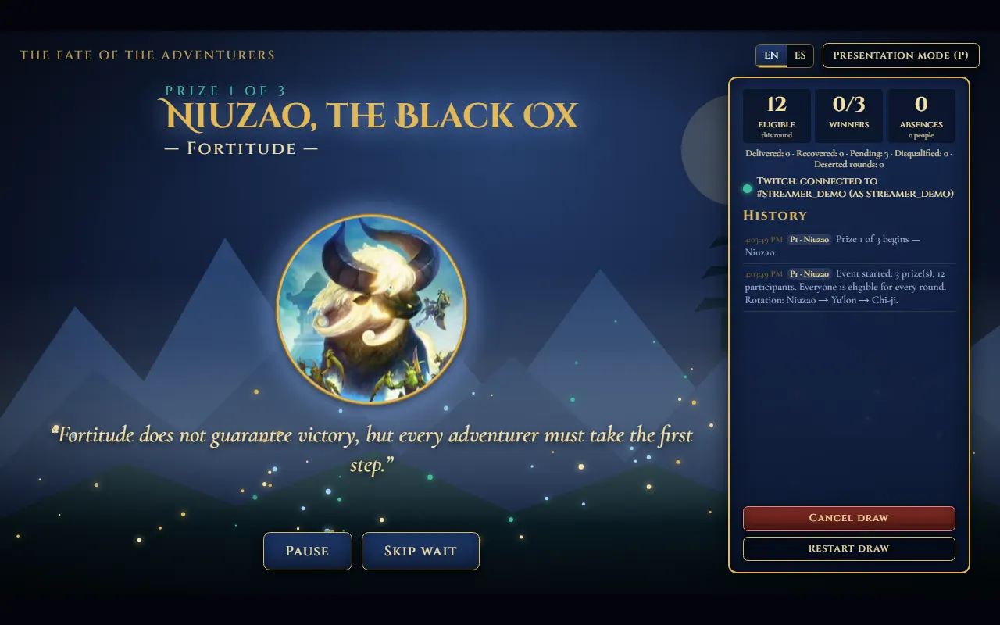

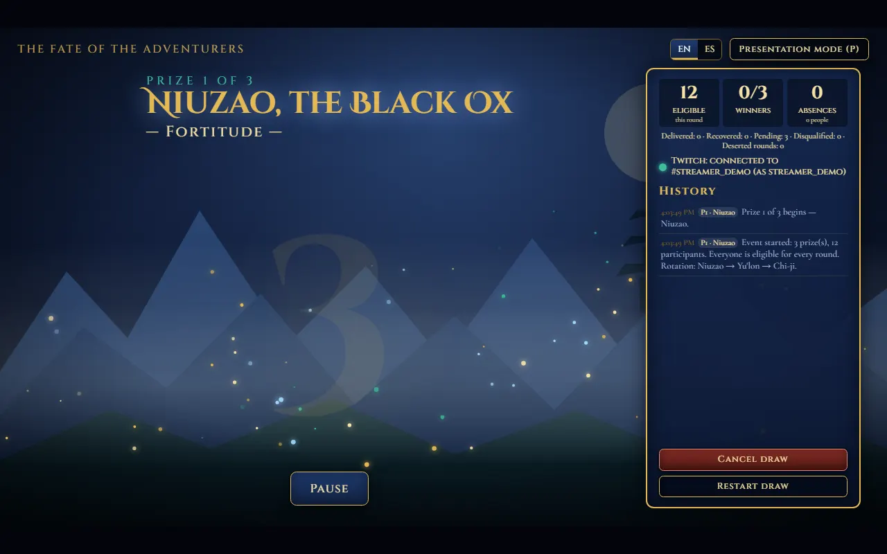

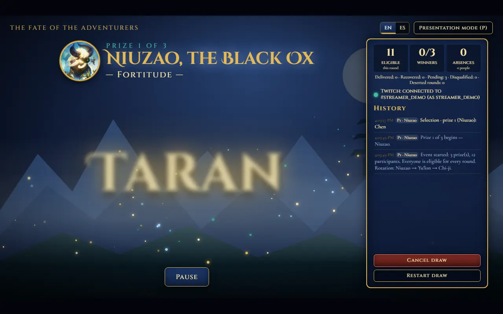

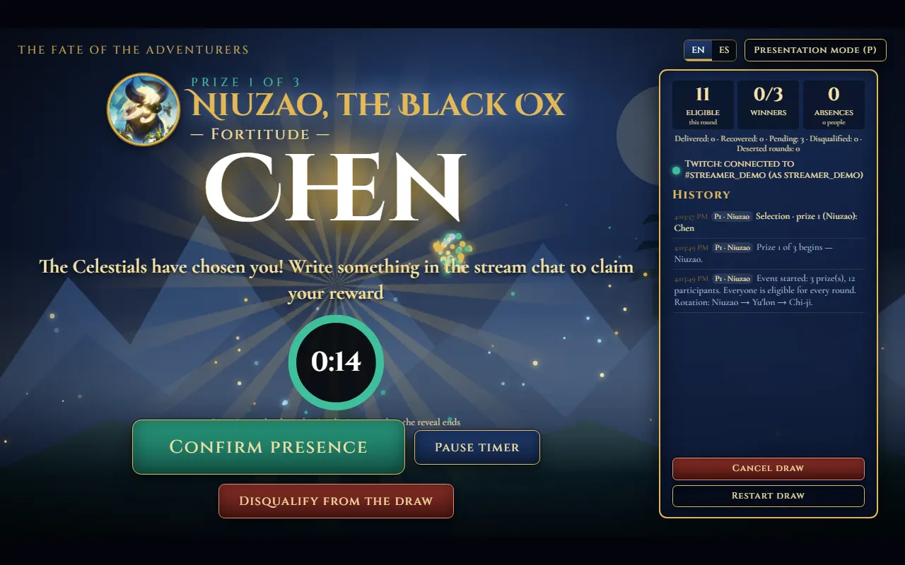

**Waiting for the chat.** From the reveal on, the server listens to the chat: the first message from the chosen person (matched by their Twitch ID) confirms them. You can also **pause**, **disqualify** (with a confirmation and a written reason) or **confirm manually**.

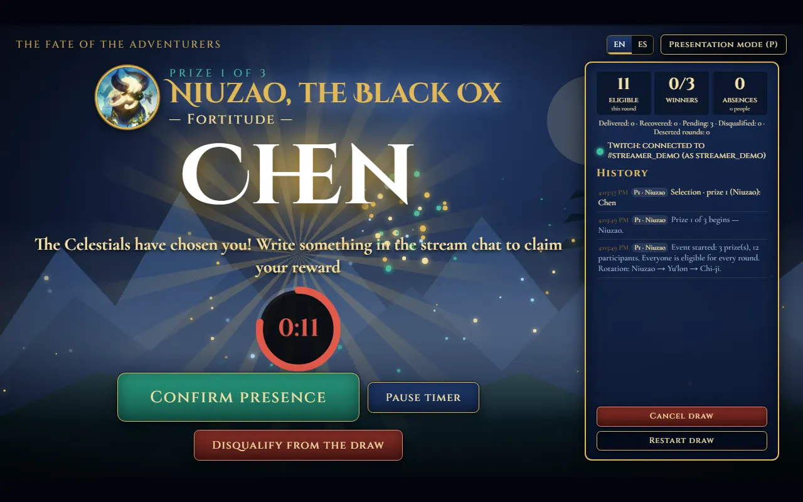

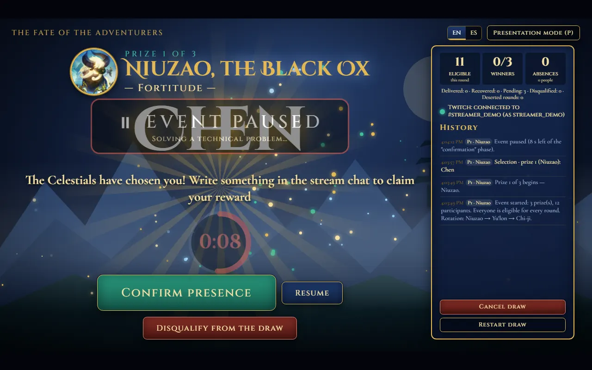

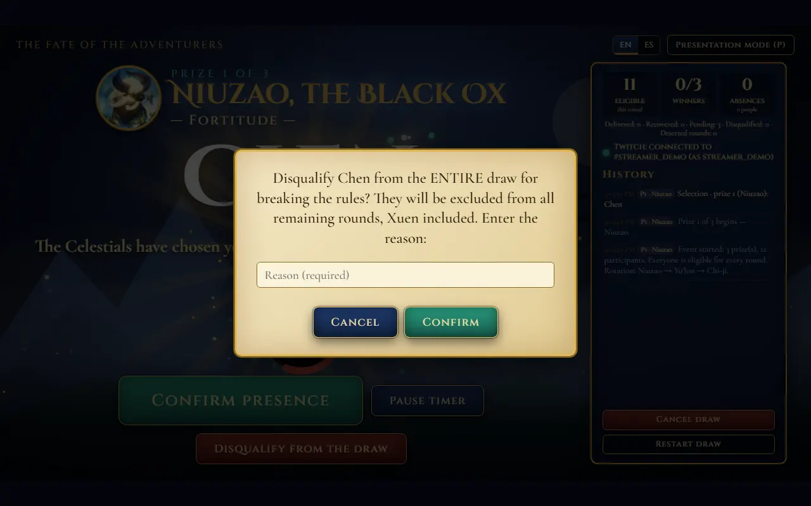

**Winner and transition.** A confirmed winner is shown, then the next round starts with the next Celestial.

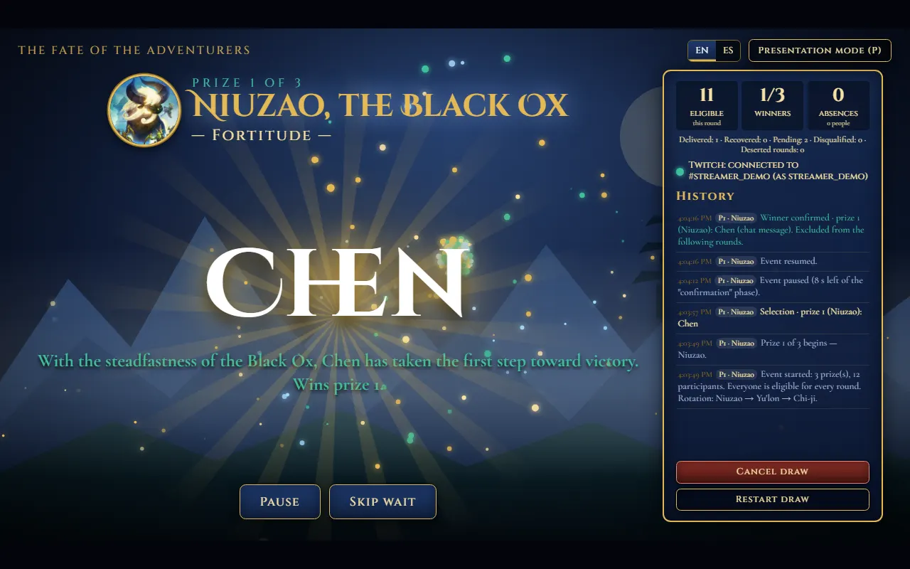

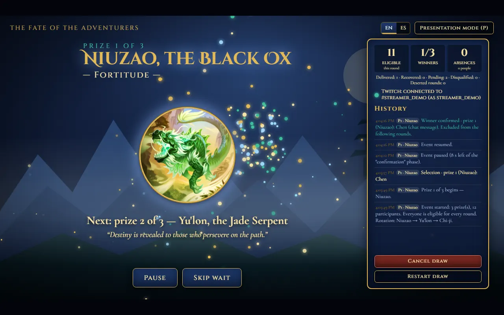

**Connection drop.** If the Twitch connection is not reliable when the time runs out, **nobody is declared absent**: the state becomes *Verifying*, and once the connection is back the chosen person gets extra time.

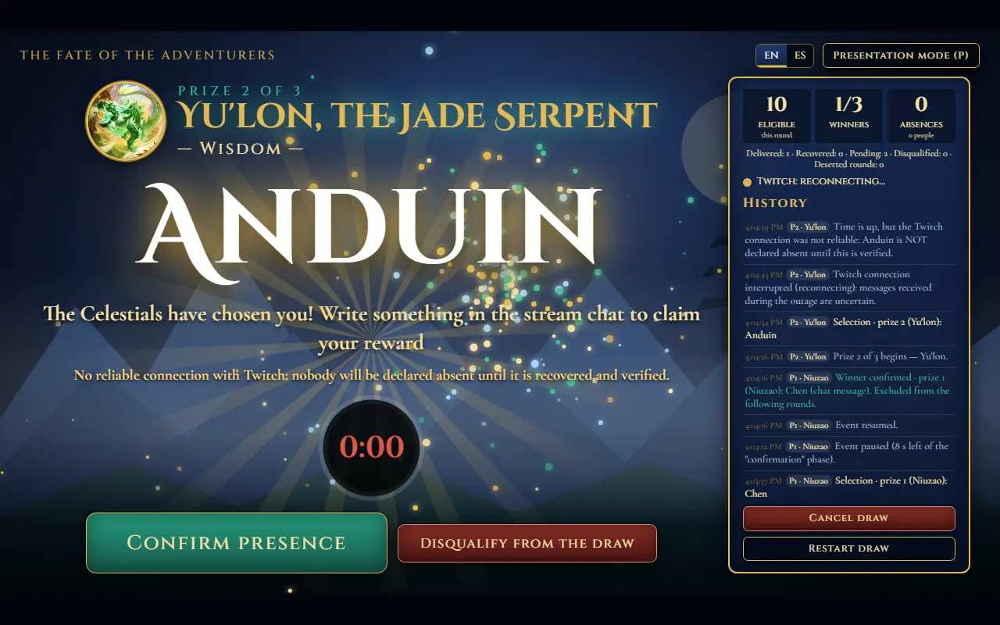

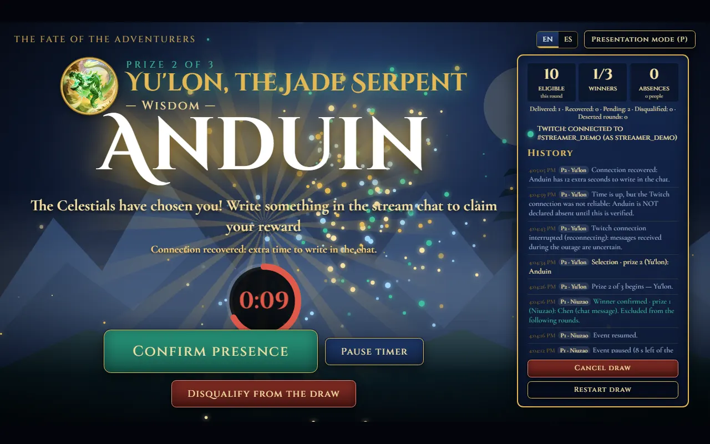

**Absence.** If the time runs out with a reliable connection, the person is shown as absent (excluded from that round only) and another candidate is drawn.

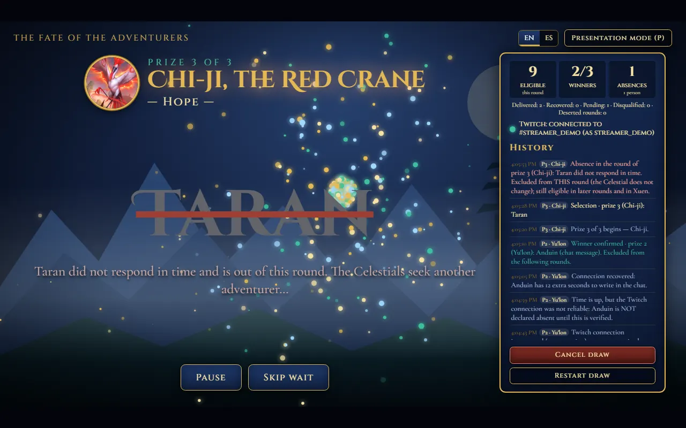

**Final screen and history.** When every prize is assigned (or recovered by Xuen), the winners are shown with their Celestial; the presenter hands the codes over personally.

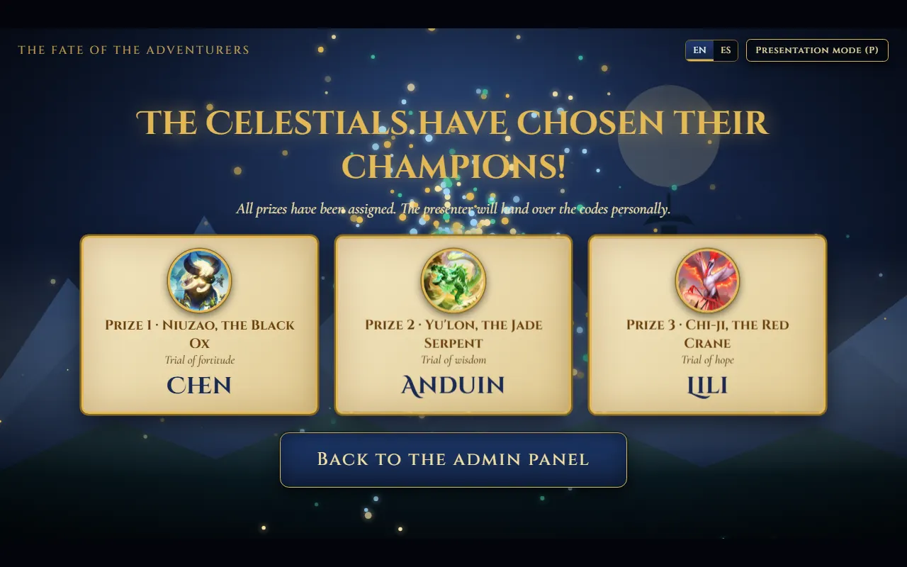

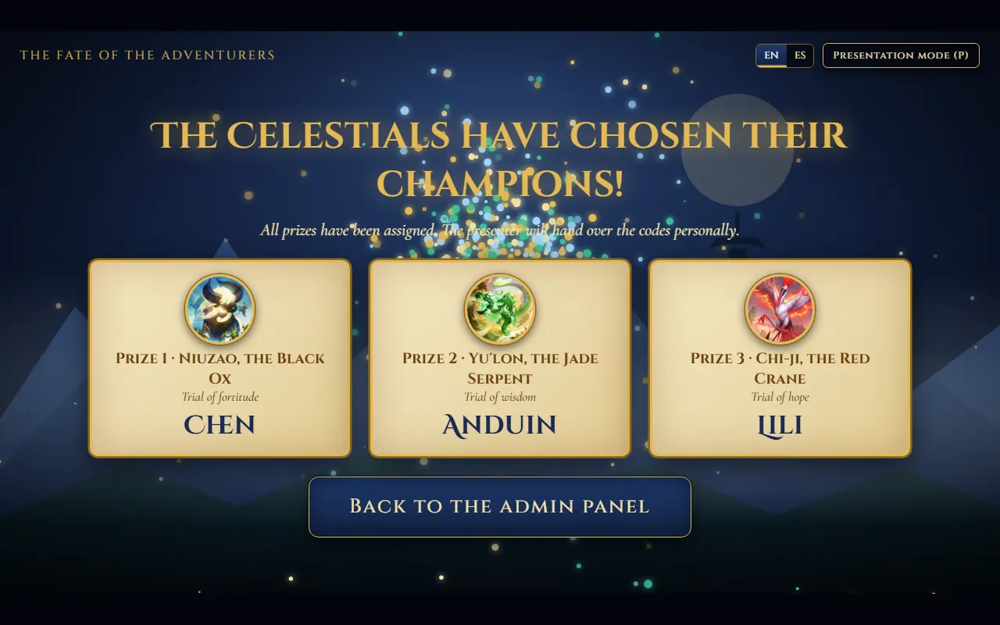

### Rotation of the Celestials
The main rounds rotate **circularly** between Niuzao, Yu'lon and Chi-ji until all prizes are complete. The Celestial depends on the **round index**, not on the winners. An **absence does not change the Celestial**: another participant is chosen under the same one. The rotation only advances when a winner is confirmed or the round ends deserted.

### Eligibility
Everyone starts eligible for every round. Each draw is made among those eligible *for the current round*:

| Situation | Effect |
|---|---|
| **Absence** (does not write in time) | Excluded **from that round only** (not from that Celestial: absent in prize 1 of Niuzao, they can come up in prize 4 even though it is Niuzao again). Can take part in later rounds and in Xuen. |
| **Confirmed winner** | Excluded from everything afterwards. Each person wins at most one prize. |
| **Global disqualification** (explicit, by the presenter) | Asks for confirmation and a **required reason**. Excluded from all remaining rounds, Xuen included. |
| **Round with no eligible participants** | Declared **deserted**: its prize moves to recovery and the event continues with the next round. |

Eligibility is always computed from the records (`core.js → eligible()`), not from a set that keeps shrinking.

### Xuen — Strength (recovery)
The Celestial **exclusive** to the recovery rounds; it is not a mandatory trial. When the main rounds finish:
- **Every prize has a winner** → the event ends; Xuen does not appear.
- **Prizes are still pending** → Xuen activates by itself and tries to assign each one (all under Xuen, never alternating with the others). Xuen winners receive the pending prizes **in order** (lowest number first).
- Winners and disqualified people do not take part; **people absent in the main rounds do**. Someone **absent in Xuen** is excluded from the **whole** recovery.
- If the candidates run out, the remaining prizes stay **permanently unassigned** and the event ends as incomplete.

### States and history
Each prize has a state: *pending*, *in progress*, *delivered*, *in recovery* (deserted round), *recovered by Xuen* or *unassigned*. The screen shows prizes delivered / recovered / pending, and tells **absence events** apart from **unique absent people**. The history (on screen and in `data/streamers/<twitch-id>/historial.jsonl`) carries the prize, the Celestial and whether it was a main or a recovery round.

**OBS:** add a *Browser source* with `http://localhost:3000/?view=presentation` (no controls; the buttons only appear when you hover the bottom area). You can also use the `P` key in the normal panel.

## Deploying on Railway (optional, remote mode)

By default the server is local-only (`127.0.0.1`, no sign-in to the panel). To run it on a public host such as [Railway](https://railway.com) it needs a long-running Node process, so static hosts (GitHub Pages) and serverless platforms (Vercel) do not work.

1. **Service**: create a Railway service from this repository. `railway.json` sets the start command and the `/healthz` health check; the platform provides `PORT`.
2. **Volume**: add a volume and mount it (e.g. at `/data`); set `DATA_DIR=/data` so tokens, settings and history survive redeploys.
3. **Variables** (Railway → Variables, never in the repository): `TWITCH_CLIENT_ID`, `TWITCH_CLIENT_SECRET`, `TWITCH_CHANNEL`, `DATA_DIR`, and
   - `PUBLIC_URL`: the public HTTPS origin, e.g. `https://your-app.up.railway.app` (no path). Setting it turns on **remote mode**.
   - `ALLOWED_LOGINS`: Twitch logins allowed to sign in, comma-separated, or `*` to let **any** Twitch account in (defaults to `TWITCH_CHANNEL`).
   - `MAX_STREAMERS` (optional, default 20): how many streamers can be connected at once; each keeps its own connection to Twitch.
4. **Twitch console**: add `PUBLIC_URL/auth/callback` to the application's OAuth Redirect URLs (it must match `TWITCH_REDIRECT_URI`, which defaults to that value).
5. Open `PUBLIC_URL` and sign in with Twitch.

**Several streamers at once:** every streamer who signs in gets their own Twitch connection, tokens, draw engine, settings and history; the session cookie carries their Twitch ID, so each person only sees and controls their own event. In remote mode each streamer reads **their own channel's chat** (`TWITCH_CHANNEL` is ignored). A streamer who logs out with no event running is released from memory; with an event running it is kept until it ends.

In remote mode: the panel, the state stream and every command require a session (HttpOnly, Secure, SameSite=Lax cookie, 12 h) obtained by signing in with an allowed account; any other account is rejected before anything is stored. `Host` and `Origin` must match `PUBLIC_URL`. The server refuses to start without an `https://` `PUBLIC_URL` and a list of allowed accounts. Sessions live in memory, so a restart asks you to sign in again (the Twitch tokens persist on the volume). `/healthz` returns `ok` and no data.

## Languages (i18n)
The interface is available in **English (default)** and **Spanish**, following the same convention as DocFlow: English is the default language **regardless of the browser's language**.
- **EN | ES switch** in the top-right corner. The choice is remembered in the browser (`localStorage`: `celestiales.locale`) and can also be forced with `?lang=es` (handy in the OBS browser source: `http://localhost:3000/?view=presentation&lang=es`).
- Switching is instant and translates **everything**, including the history already generated: the engine stores *keys and parameters* and the page translates them into the active language. `historial.jsonl` also stores the English text.
- The server's error pages (OAuth) use the chosen language (`celestiales_lang` cookie). The server console is in English; with `LANG_UI=es` it prints in Spanish.
- Participant names and the reasons you type are **never translated**.
- **Texts:** `locales/en.js` and `locales/es.js` (including the Celestials' narrative texts, `story.*`). **Adding a language:** copy `locales/en.js` to `locales/xx.js`, translate it, register it in `i18n.js` (`SUPPORTED` and the loaders at the top), in `server.js` (shared-files list) and as a `<script>` in `public/index.html`/`index.html`. A missing key falls back to the English one. The tests check that both catalogs have the same keys and parameters and that every used key exists.

## How integrity is guaranteed
| Requirement | Implementation |
|---|---|
| Randomness and records on the server | `core.js`: `crypto.getRandomValues` with rejection (no modulo bias). The browser only sends commands; it does not receive the candidate's name until the reveal. |
| Identity | Twitch's `chatter_user_id` is compared with the candidate's resolved ID (not the name text). Everyone else is ignored. |
| Idempotency | Repeated `metadata.message_id` (EventSub layer) and repeated chat `message_id` (draw layer) are discarded. |
| A single timer | Every phase (animations, waits and the time limit) goes through one scheduler that cancels the previous phase; a callback from an already replaced phase is ignored. |
| Time limit vs. message | Single point of resolution (`settle`): the first valid result wins. An expired time limit is processed **only once** and later messages are not accepted. |
| Delivery margin | After 0:00 there are `lateSec` (3 s by default) during which a message sent just before can still arrive and confirm; past that margin it is not accepted. With `0` the mode is strict. |
| Connection drop | If the connection is not reliable during the window, **nobody is declared absent**: the state becomes *Verifying*. Once it recovers, extra time (`graceSec`) is granted and a message from the chosen person confirms them. |
| Reconnection | Gapless `session_reconnect`; keepalive loss → exponential retries; automatic token refresh; hourly validation. |
| Prize codes | Neither shown nor stored. |

## Limitations and things that need attention
- **Twitch does not resend lost messages** during a WebSocket drop and offers no official chat-history API. After an outage the extra time is granted; if the chosen person had already written during the outage, use **Confirm presence** if you see it in the chat.
- **Total duration:** with the default timings each prize takes about 30–35 s of animations and waits *plus* the confirmation time; a large draw can take a long time. Adjust the timings or use *Skip wait*.
- **Pause:** it pauses the current phase (including confirmation); during the delivery margin after 0:00 it cannot be paused.
- The names in the list must be Twitch **logins** (letters, numbers and `_`). They are verified on Twitch at start.
- At most 3 WebSocket connections per user token: do not run two instances of the server at once.
- If you read the chat of **another channel** (`TWITCH_CHANNEL`), the authorized account must be able to read that chat.
- If you **restart the server** in the middle of a draw, the state is **not restored** (the history on disk and the saved settings remain). Refreshing the page (F5) has no effect: the server is the source of truth.
- The server only listens on `127.0.0.1` and rejects requests with a foreign `Host`/`Origin`; do not expose it to the internet.
- **Not verified against real Twitch** (there are no credentials in the development environment): the logic, the protocol according to the official documentation and the full interface were checked against a simulated Twitch. Do a **real test before the stream** with an account included in the list.

## Tests
```bash
node --test
```
74 tests (~25 s): settings (defaults, validation of negatives/decimals/text/ranges/prizes > participants), rotation (1, 3, 5, 8 and 10 prizes), absences that do not change the Celestial, per-round eligibility, winners, global disqualification, deserted rounds, Xuen (activation, several prizes, absentees, exhaustion), timers with a **simulated clock** (configurable time limit, starts after the reveal, expires only once, delivery margin, strict mode, pause, a single active timer, restore), locked settings, restart without inherited exclusions, connection drops and the OAuth/EventSub protocol with simulated WebSocket and `fetch`. **i18n** tests: English by default, EN/ES key and parameter parity, coverage of the keys in use, plurals, fallback to English and the server page by cookie. One test checks that `core.js`, `i18n.js` and `locales/` are identical in the manual version.

## Structure
```
core.js          shared core: settings, rotation, eligibility and the event engine (identical in the manual version)
i18n.js          internationalization (default language EN) · locales/en.js, locales/es.js: catalogs (identical in the manual version)
game.js          Twitch wrapper: verified list, identities, persisted settings, history
server.js        local HTTP server, OAuth, SSE and commands
twitch.js        OAuth + EventSub WebSocket (reconnection, dedupe, token refresh)
public/index.html  interface (only shows the state and sends commands)
tests/           automated tests
store.js         per-streamer data: data/streamers/<twitch-id>/ (config + history)
tenants.js        one connection + engine per signed-in streamer
data/            streamers/<twitch-id>/ with tokens.json, config.json and historial.jsonl (generated, outside version control)
```
